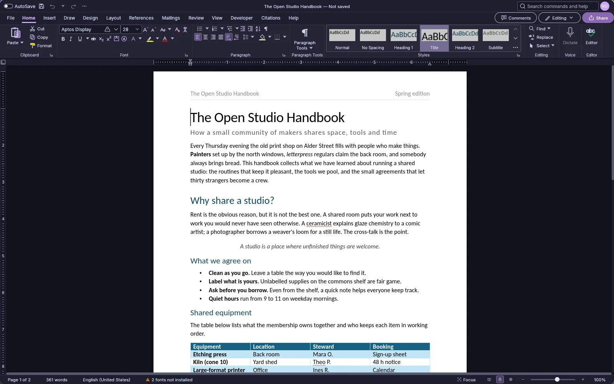

<p align="center"></p>

# VDoc

VDoc is the word processor of [Vyntaris Office](https://vyntarisos.com/), the office suite of the
Vyntaris desktop. It opens and saves Word documents (`.docx`, `.dotx`), reads `.doc`, OpenDocument
`.odt`, RTF, Markdown, HTML and plain text, and exports PDF. Password-protected documents open with
their password and are saved with it again.

It is a fork of [WordCraft](https://github.com/storytold/wordcraft) by the ArtCraft Team. The
layout engine, the file formats and the interface are WordCraft's; this repository adds what
Vyntaris needs and keeps up with WordCraft's changes.



## Install

On Vyntaris it is optional: the `vdoc` package from the `[vyntaris]` repository.

```sh
sudo pacman -S vyntaris-office   # VDoc, VSheet and VSlide together
sudo pacman -S vdoc              # or only VDoc
```

Updates come with the rest of the system (`sudo pacman -Syu`). VDoc never updates itself; Help ›
Check for Updates says so.

## What Vyntaris changes

- **The desktop's colours.** The Vyntaris shell writes its theme as a Craft theme
  (`~/.config/ArtCraft/themes`), which VDoc follows live, light or dark, with the desktop's accent.
- **Its own identity.** App id `org.vyntaris.VDoc`, its own icon and desktop entry
  (`packaging/linux/`), and an About window that points here and to WordCraft. No ArtCraft Discord
  button.

Everything else works as in WordCraft.

## Build

Rust 1.95 or newer:

```sh
cargo run --release -p vdoc              # the app
cargo run --release -p vdoc -- letter.docx
cargo test -p vdoc-engine -p vdoc-ui-egui
```

The Vyntaris package builds `cargo build --release --locked -p vdoc` and installs the binary,
`packaging/linux/org.vyntaris.VDoc.{desktop,metainfo.xml}` and the icons from
`assets/app-icon/hicolor/*/apps/org.vyntaris.VDoc.*`.

## Branches

- `vyntaris` (default): VDoc.
- `upstream`: WordCraft's history with its name replaced by VDoc. New WordCraft releases are
  brought in by merging it into `vyntaris`.
- `main`: WordCraft as it is, kept for reference.

## Licence

MIT OR Apache-2.0, as WordCraft (`LICENSE-MIT`, `LICENSE-APACHE`). `NOTICE` names what comes from
WordCraft and what Vyntaris added. VDoc doesn't use the ArtCraft name or logos.

Bugs: [github.com/vyntaris/vdoc/issues](https://github.com/vyntaris/vdoc/issues).
